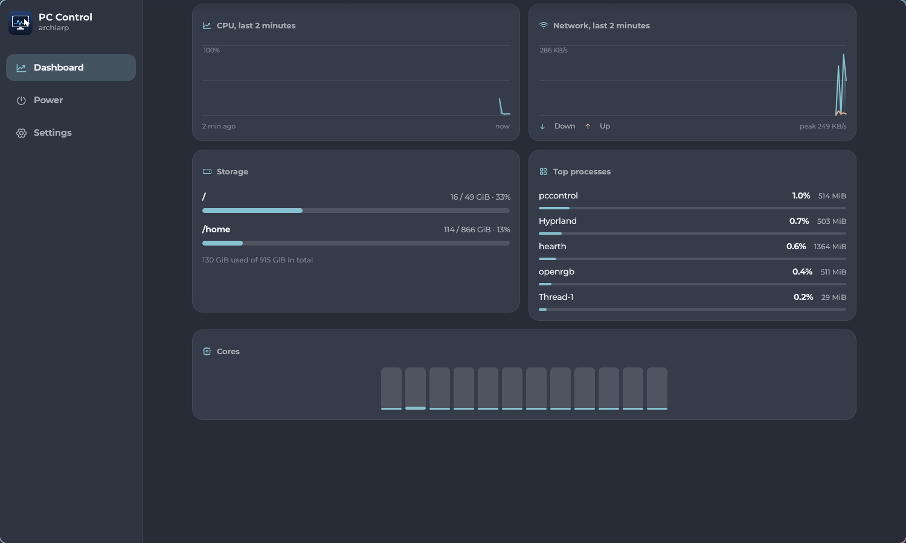
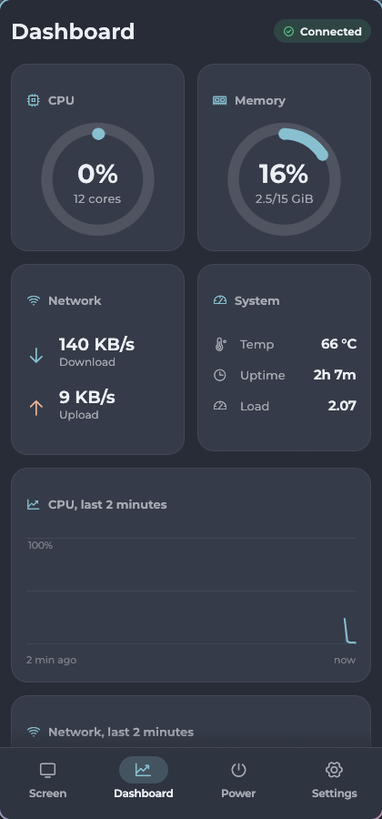
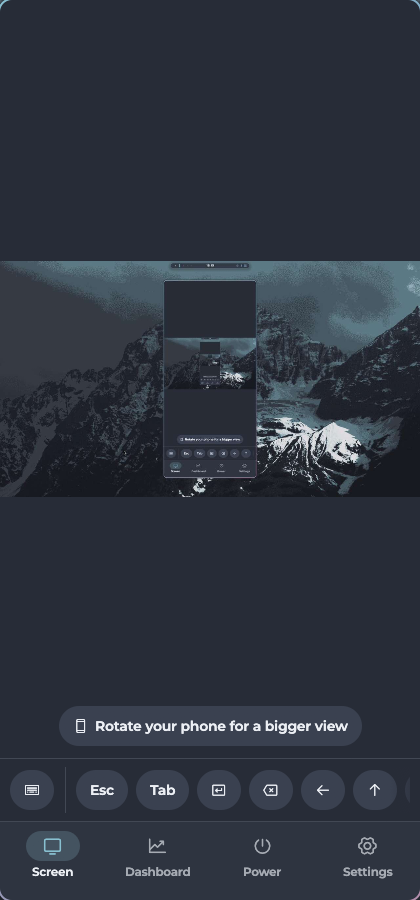
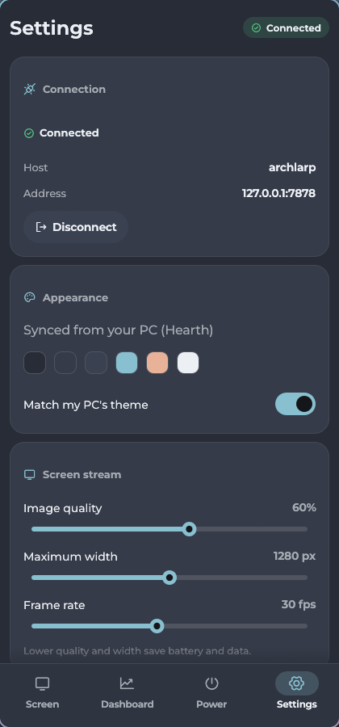

# PC Control

Lightweight Rust remote control for a Linux PC: live screen, mouse/keyboard, system stats and power actions, from your phone (APK) or another PC.

- **Host** (`pccontrol-host`): tiny daemon (~5 MB RAM, 0% CPU when no client is connected). Captures the screen only while a client is viewing it, skips unchanged frames, injects input through `uinput`.
- **Client** (`pccontrol`): one egui app for Android and Linux desktop. The phone gets the remote screen, touch/keyboard control, dashboard and power actions; the desktop app is dashboard + power only (no screen view) and connects to the local host automatically.
- **Theming**: the desktop app follows your desktop colours (Hearth/Quickshell, KDE `kdeglobals`, GTK `@define-color` files, or the XDG portal light/dark + accent, which covers GNOME and most others). The host forwards the same colours to the phone, so both match your PC; this can be switched off in Settings.
- **Security**: TLS with a self-signed certificate pinned via the pairing code, plus a random token. Don't expose port 7878 to the internet; use Tailscale/WireGuard when away from home.



| Phone: dashboard | Phone: screen | Phone: settings |
|---|---|---|
|  |  |  |

`docs/screenshots/b-*.png` are the visual bugs found during polishing (layout overflow on narrow windows, low-contrast confirm tile, oversized sliders, …); `a-*.png` are the fixed versions. They were captured with `scripts/dev-shot.sh`.

## Updates

Settings → Updates checks GitHub for the newest release (on start and every 6 hours). On the PC, **Update** downloads the new AppImage, verifies its checksum, installs it and restarts the host service. On Android it hands the APK to the system download manager; open the notification to install. **What changed** shows the patch notes bundled with the app, and after an update the notes appear once.

## Install (Arch / Linux PC)

```bash
chmod +x PC-Control-x86_64.AppImage
./PC-Control-x86_64.AppImage install     # installs to ~/.local/bin, enables the user service, prints pairing code
```

Requirements: a wlroots-style Wayland compositor (Hyprland, Sway, …) for capture, access to `/dev/uinput` (member of `input` or a uaccess ACL), `mesa`/`libdrm`, port 7878/tcp open on your LAN.

`PC-Control-x86_64.AppImage` opens the desktop client; `... pair` prints the pairing code; `... run` starts the host in the foreground.

## Phone

Install `dist/pc-control.apk` (allow installs from unknown sources), copy the pairing code from `pccontrol-host pair` to the phone, tap **Paste from clipboard**, then **Connect**.

Touch: tap = click, drag = move pointer, two-finger drag = scroll, toggles for hold-drag and right-click, on-screen keys for Esc/Tab/arrows/Ctrl/Alt/Shift/Super.

## Build

```bash
cargo build --release                    # host + desktop client
scripts/build-appimage.sh                # dist/PC-Control-x86_64.AppImage
scripts/build-apk.sh                     # dist/pc-control.apk (needs Android SDK/NDK 26, JDK 17, cargo-apk)
```

## Limitations

- Capture needs a wlroots screencopy compositor (not GNOME/KDE yet); the first output/all outputs are captured.
- Remote text input is US-layout ASCII; other characters are ignored.
- The Android build is untested on hardware at the time of writing.
- Theme detection is checked on Hearth only; KDE/GTK/portal paths are unit-tested parsers.
